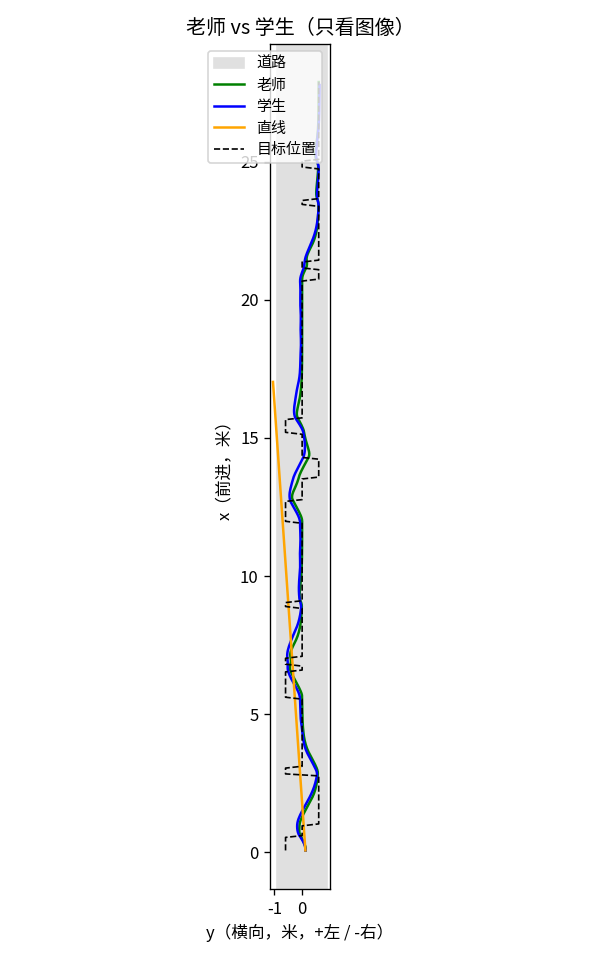
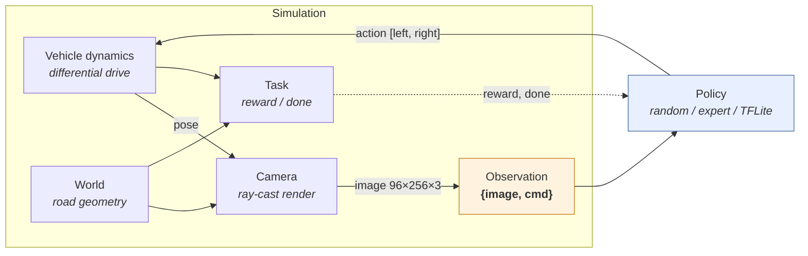
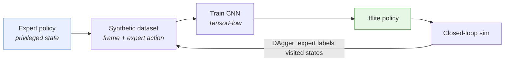
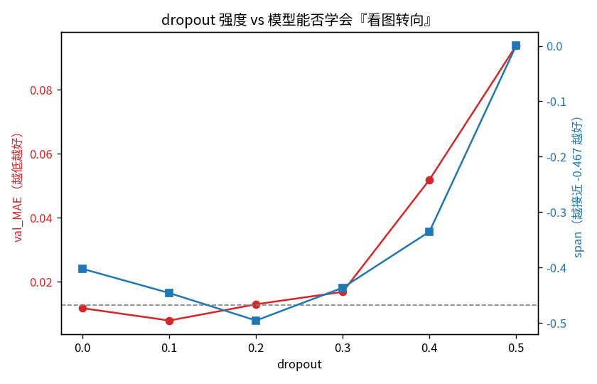
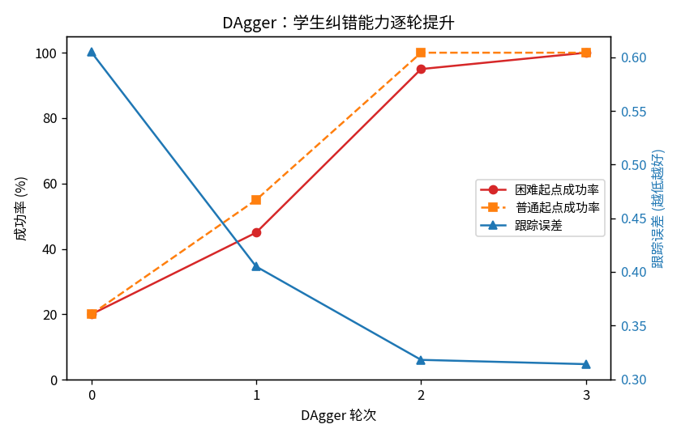
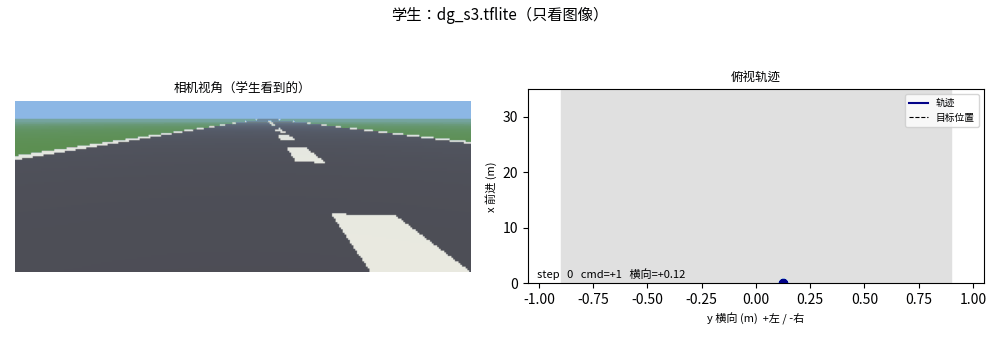
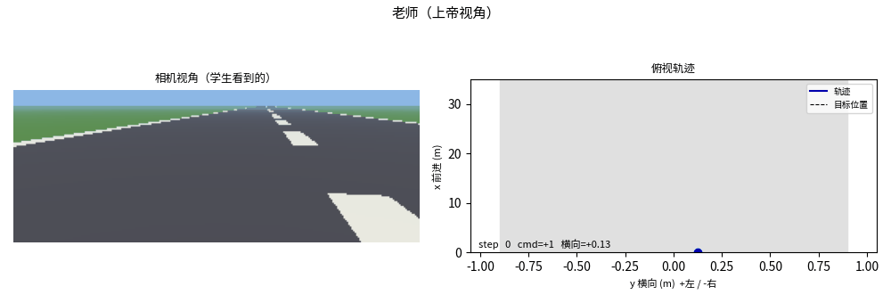
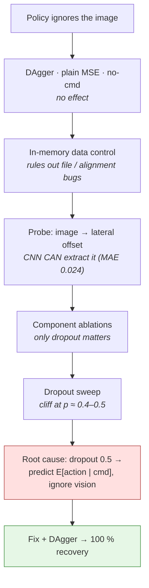

<div align="center">

# OpenBot-Sim

**Turning smartphones into robots — in simulation.**

A from-scratch simulation and imitation-learning pipeline for the
[OpenBot](https://www.openbot.org/) smartphone robot, built to study
**behaviour-cloning failure modes** and **sim-to-real transfer**.

[](#)
[](https://github.com/LuC-lis/openbot-sim-statistics)
[](#)
[](LICENSE)
[](#the-interface-contract)



<sub>The learned policy (blue) tracks the commanded target (dashed) as closely as the expert (green).</sub>

</div>

---

## Contents

- [Why this exists](#why-this-exists)
- [Architecture](#architecture)
- [Key results](#key-results)
- [Quick start](#quick-start)
- [Repository layout](#repository-layout)
- [The interface contract](#the-interface-contract)
- [The investigation](#the-investigation)
- [Environment & GPU notes](#environment--gpu-notes)
- [Status & roadmap](#status--roadmap)
- [Attribution](#attribution)

---

## Why this exists

OpenBot is a ~$50 robot whose "brain" is an Android phone running a small
vision network. Training such a policy the usual way means driving a real car
for hours. This project asks a different question:

> **Can I build the whole loop in simulation — and, more importantly, understand
> exactly how and why such learned policies fail?**

So instead of downloading a simulator, everything here is written from scratch:
the vehicle dynamics, the camera, the world, the task, and a Gym-style loop —
with the **observation/action interface matched exactly to the real OpenBot
stack**, so anything trained here is drop-in compatible with the Android app.

It is an **independent, self-directed project**, still in progress.

> The evaluation in this repository is a single run per configuration. The
> statistical companion, [openbot-sim-statistics](https://github.com/LuC-lis/openbot-sim-statistics),
> runs the same simulator as a designed experiment: Latin-hypercube conditions,
> paired seeds across policies, Wilson/bootstrap intervals, permutation tests and
> a logistic regression on the failure indicator.

---

## Architecture



The training loop adds imitation learning on top:



---

## Key results

| Finding | Evidence |
|---------|----------|
| Built a simulation whose interface is **identical to OpenBot's Android stack** | [`openbot_sim/`](openbot_sim) · [interface table](#the-interface-contract) |
| The default policy architecture silently **ignores its camera** and regresses to open-loop control | [`experiments/probe_ablation.py`](experiments/probe_ablation.py) |
| Root cause isolated to **dropout (p = 0.5)**, with a sharp cliff at p ≈ 0.4–0.5 | [`results/dropout_sweep.png`](results/dropout_sweep.png) |
| **DAgger** raises closed-loop recovery from **20% → 100%** in three rounds | [`results/dagger_progress.png`](results/dagger_progress.png) |
| GPU workflow: peak memory **8.4 GB → 1.9 GB**, **~4–5× faster** epochs | [`scripts/train.py`](scripts/train.py) |

### 1 · Dropout induces shortcut learning

Disabling **only** dropout restores vision-based steering; disabling batch-norm or
the command concatenation does not. Sweeping dropout shows learning up to p ≈ 0.3,
degradation at p ≈ 0.4, and **total collapse at p = 0.5**.

<p align="center"></p>

### 2 · DAgger closes the loop

| DAgger round | Frames | Hard-start success | Tracking error |
|:---:|---:|---:|---:|
| 0 — behaviour cloning | 1,600 | **20 %** | 0.605 |
| 1 | 4,000 | **45 %** | 0.405 |
| 2 | 6,165 | **95 %** | 0.318 |
| 3 | 8,565 | **100 %** | 0.314 |

<p align="center"></p>

### 3 · Closed-loop driving

<table>
<tr>
<td><br><sub>Learned policy (camera only)</sub></td>
<td><br><sub>Expert (privileged state)</sub></td>
</tr>
</table>

---

## Quick start

```bash
git clone https://github.com/LuC-lis/openbot-sim && cd openbot-sim
pip install -r requirements.txt
```

**Pure-python demos** (no TensorFlow needed):

```bash
python demos/m1_demo.py     # state + dynamics + world
python demos/m2_demo.py     # camera views          -> results/m2_views.png
python demos/m3_demo.py     # closed loop           -> results/m3_trajectory.png
python demos/m4_demo.py     # expert policy         -> results/m4_trajectory.png
python demos/tiny_nn.py     # a neural net written from scratch in numpy
```

**Full pipeline** — data → train → drive → evaluate:

```bash
python scripts/export_data.py --train-episodes 4 --test-episodes 1   # -> output/dataset
python scripts/train.py --arch simple --epochs 15 --out models/student.tflite
python demos/m5_demo.py      --model models/student.tflite
python scripts/evaluate.py   --model models/student.tflite --episodes 20 --disturb 0.02
```

> **TensorFlow installed via pip + `nvidia-*-cu12` wheels?** TensorFlow will not
> find the CUDA libraries on its own. Run CUDA scripts through the helper:
> ```bash
> ./scripts/cuda_run.sh scripts/train.py --epochs 15
> ```

**Using your own model:** verify it matches the interface first, then drive it.

```bash
python scripts/check_model.py --model path/to/model.tflite
python demos/m5_demo.py --model path/to/model.tflite
```

---

## Repository layout

```
openbot_sim/     core simulation library (packaged, importable)
  state.py         robot state (x, y, θ)
  dynamics.py      differential-drive kinematics
  world.py         road geometry
  camera.py        forward pinhole camera + ground-plane ray casting
  task.py          reward and termination
  observation.py   observation assembly (the interface contract)
  spaces.py        observation / action spaces
  env.py           Gym-style reset() / step() loop
  policies.py      random · expert · TFLite policies
  nets.py          network definitions (self-contained)

scripts/         data, training and evaluation
  export_data.py   expert drives → OpenBot-format dataset
  dagger.py        DAgger data aggregation
  train.py         configurable trainer (architecture, dropout, quantization)
  evaluate.py      multi-episode robustness evaluation
  check_model.py   verify a .tflite matches the interface
  cuda_run.sh      expose pip CUDA libraries to TensorFlow

experiments/     the diagnostic study
  probe_inmem.py     in-memory data control      (rules out data/alignment bugs)
  probe_lateral.py   image → lateral-offset probe (can the CNN see the state?)
  probe_ablation.py  component ablations          (dropout vs. BN vs. cmd-concat)
  probe_dropout.py   dropout sweep                (quantifies the cliff)

demos/           visual demos and teaching scripts
results/         figures and videos
models/          final trained policy (dg_s3.tflite, int8-quantized)
```

---

## The interface contract

The simulator reproduces OpenBot's real interface exactly, so trained `.tflite`
models are **drop-in compatible** with the Android app:

| Quantity | Specification | Source in OpenBot |
|----------|---------------|-------------------|
| Image | `(96, 256, 3)` float32 in `[0, 1]` | `android/.../tflite/Autopilot.java`, `assets/config.json` |
| Command `cmd` | scalar in `{-1, 0, +1}` | `Autopilot.java`, `utils/Enums.java` |
| Action | `[left, right] ∈ [-1, 1]` | `vehicle/Control.java` |
| Serial encoding | `c<int(left·255)>,<int(right·255)>` | `python/infer.py` |

---

## The investigation

A policy trained on an expert dataset looked fine (low validation error) but
drove poorly in closed loop. The diagnosis followed a strict elimination:



A detailed write-up (Chinese) is in [`README.zh-CN.md`](README.zh-CN.md).

---

## Environment & GPU notes

- **CPU only** — `numpy`, `matplotlib`, `Pillow`, `tensorflow`; enough for all demos.
- **GPU (recommended for training)** — TensorFlow 2.15.1 requires **CUDA 12.2 /
  cuDNN 8.9** (*not* 11.8, a common source of confusion). If CUDA comes from the pip
  `nvidia-*-cu12` wheels, TensorFlow will not locate it automatically —
  `scripts/cuda_run.sh` sets `LD_LIBRARY_PATH` and `--xla_gpu_cuda_data_dir`.

---

## Status & roadmap

- [x] Simulation environment (dynamics, camera, world, task, Gym-style loop)
- [x] Expert policy, dataset export, DAgger
- [x] Behaviour-cloning trainer + TFLite export (with quantization)
- [x] Diagnostic study (ablation + dropout sweep) and fix
- [ ] Domain randomisation (textures, lighting, camera pose, noise)
- [ ] Real-data fine-tuning and sim-to-real transfer
- [ ] Deployment on a physical OpenBot

---

## Attribution

The interface contract and network architecture follow
[OpenBot](https://github.com/ob-f/OpenBot) (Müller & Koltun, *OpenBot: Turning
Smartphones into Robots*, ICRA 2021, Apache-2.0).
[`openbot_sim/nets.py`](openbot_sim/nets.py) is a minimal, self-contained
re-implementation so that this repository has **no dependency on the OpenBot
source tree**.

## License

MIT — see [LICENSE](LICENSE).
